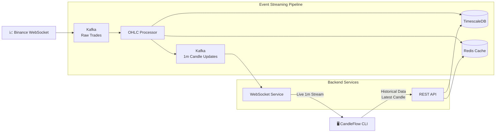

# 🏗️ CandleFlow Architecture

## Overview

CandleFlow follows an **event-driven microservices architecture** designed for processing and distributing real-time cryptocurrency market data.

Each service has a single responsibility and can be independently developed, deployed, and scaled.

Communication between services is asynchronous through Apache Kafka wherever appropriate, keeping the architecture loosely coupled and fault tolerant.

---

# High-Level Architecture



---

# System Components

## 1. Ingestion Service

### Responsibility

* Connects to Binance WebSocket.
* Receives live trade events.
* Publishes every trade to Kafka.

### Dependencies

* Binance WebSocket
* Apache Kafka

---

## 2. OHLC Processor

The OHLC Processor is the core service responsible for transforming raw trades into market candles.

### Responsibilities

* Consumes raw trades from Kafka.
* Builds 1-minute OHLC candles.
* Stores completed candles in TimescaleDB.
* Updates Redis cache.
* Publishes completed 1-minute candles to Kafka.

### Dependencies

* Apache Kafka
* TimescaleDB
* Redis

### Continuous Aggregates

Only **1-minute candles** are generated manually.

Higher intervals are produced automatically by TimescaleDB Continuous Aggregates.

Supported intervals:

* 5m
* 15m
* 1h

This significantly reduces application complexity while leveraging TimescaleDB's optimized aggregation engine.

---

## 3. WebSocket Service

### Responsibility

Provides live streaming of completed 1-minute candles.

### Data Source

Kafka

### Notes

* Consumes completed 1-minute candles from Kafka.
* Broadcasts them to all connected CLI clients.
* Does **not** query TimescaleDB.
* Does **not** communicate with the REST API.

---

## 4. REST API

The REST API serves historical candle data.

### Supported Intervals

* 1m
* 5m
* 15m
* 1h

### Request Flow

```text
Client
   │
   ▼
REST API
   │
   ▼
Redis
   │
   ├── Cache Hit → Return Data
   │
   └── Cache Miss
          │
          ▼
    TimescaleDB
          │
          ▼
    Update Redis
          │
          ▼
      Return Data
```

### Responsibilities

* Historical candle retrieval
* Latest available candle retrieval
* Redis caching
* Database querying

---

## 5. CandleFlow CLI

The CLI communicates with two independent backend services.

### REST API

Used for:

* Historical candle retrieval
* Fetching the latest available candle before starting a live session

Examples

```bash
candleflow BTCUSDT --interval 5m

candleflow BTCUSDT latest

candleflow BTCUSDT --interval 15m --limit 20
```

### WebSocket Service

Used for:

* Live streaming of 1-minute candles

Example

```bash
candleflow BTCUSDT
```

### Live Session Flow

1. The CLI requests the latest available candle from the REST API.
2. The latest candle is displayed immediately.
3. The CLI establishes a WebSocket connection.
4. Live 1-minute candle updates are streamed continuously.

This approach avoids gaps between historical and live market data.

---

# Communication Matrix

| Source            | Destination       | Technology   |
| ----------------- | ----------------- | ------------ |
| Ingestion Service | Kafka             | Apache Kafka |
| Kafka             | OHLC Processor    | Apache Kafka |
| OHLC Processor    | TimescaleDB       | PostgreSQL   |
| OHLC Processor    | Redis             | Redis        |
| OHLC Processor    | Kafka             | Apache Kafka |
| Kafka             | WebSocket Service | Apache Kafka |
| CLI               | REST API          | HTTP         |
| CLI               | WebSocket Service | WebSocket    |
| REST API          | Redis             | Redis        |
| REST API          | TimescaleDB       | PostgreSQL   |

---

# Design Principles

The architecture follows several key principles.

* Event-driven architecture
* Independent microservices
* Loose coupling
* Single responsibility
* Cache-first historical retrieval
* Optimized time-series storage
* Real-time streaming

---

# Why No gRPC?

CandleFlow intentionally avoids gRPC because the system contains **no synchronous service-to-service communication**.

Each service either:

* communicates asynchronously through Apache Kafka, or
* accesses shared infrastructure such as TimescaleDB and Redis.

Since no service invokes another service's business logic directly, introducing gRPC would increase complexity without providing architectural value.

---

# Scalability

Every service can be scaled independently.

Examples:

* Multiple Ingestion Service instances can publish to Kafka.
* Multiple OHLC Processor instances can consume Kafka partitions.
* Multiple WebSocket Service instances can broadcast live updates.
* Multiple REST API instances can serve historical requests behind a load balancer.
* Kafka partitions enable horizontal scaling without modifying application logic.

---

# Architecture Highlights

* ✅ Event-driven
* ✅ Loosely coupled microservices
* ✅ Independently deployable services
* ✅ Kafka-based communication
* ✅ Redis cache layer
* ✅ TimescaleDB optimized for time-series data
* ✅ Continuous Aggregates for higher timeframes
* ✅ REST for historical data
* ✅ WebSocket for live streaming
* ✅ CLI supporting both historical and live workflows
