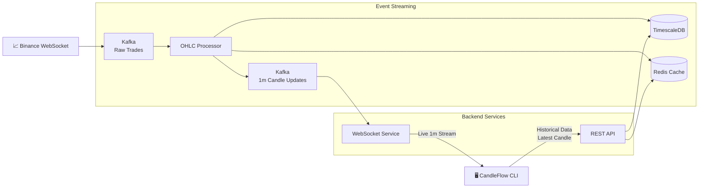

# 🕯️ CandleFlow

> A real-time cryptocurrency OHLC streaming engine built with **Apache Kafka**, **TimescaleDB**, **Redis**, **Node.js**, **WebSockets**, and **Hono**.

CandleFlow is an event-driven microservices application that ingests live cryptocurrency trades from Binance, generates 1-minute OHLC candles, stores them efficiently in TimescaleDB, caches historical queries using Redis, and provides both real-time streaming and historical candle retrieval through dedicated services.

---

## 🏗️ Architecture

---

## ✨ Features

* 📈 Real-time Binance trade ingestion
* ⚡ Apache Kafka event streaming
* 🕯️ Automatic 1-minute OHLC candle generation
* ⏱️ TimescaleDB hypertables
* 📊 Continuous Aggregates (5m, 15m, 1h)
* 🚀 Redis caching
* 🔌 WebSocket live streaming
* 🌐 REST API for historical data
* 💻 Interactive CLI

---

## 📖 Documentation

For the complete system architecture, communication flow, scalability considerations, caching strategy, and design decisions, please refer to **[ARCHITECTURE.md](./ARCHITECTURE.md)**.
